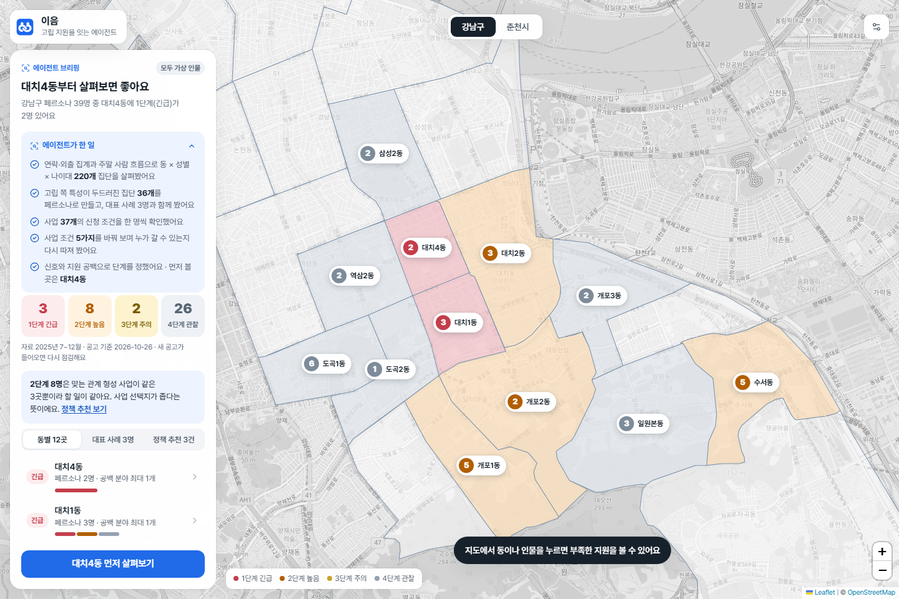
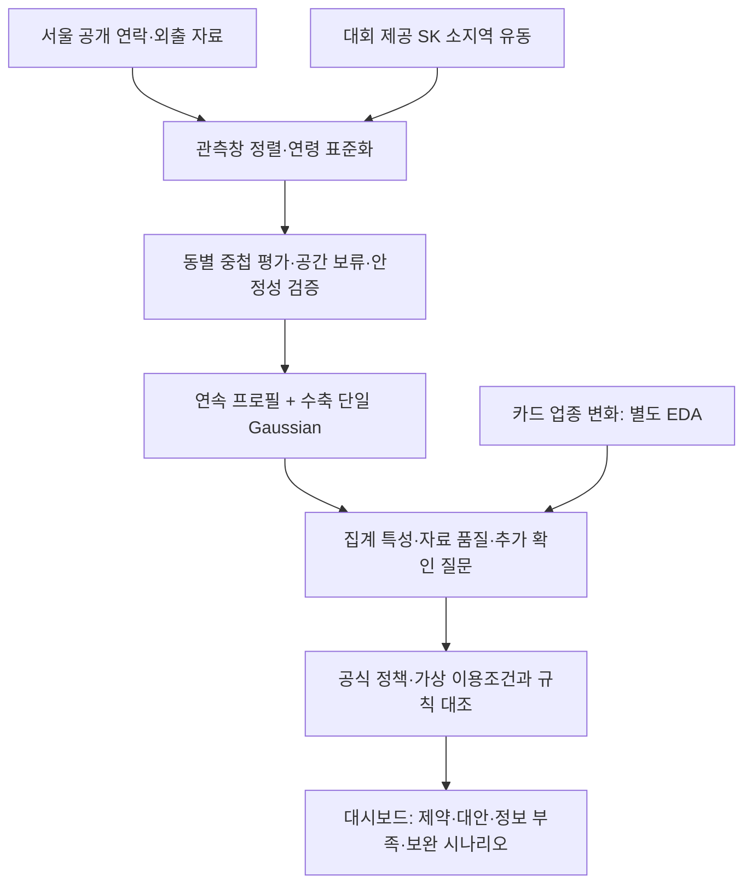
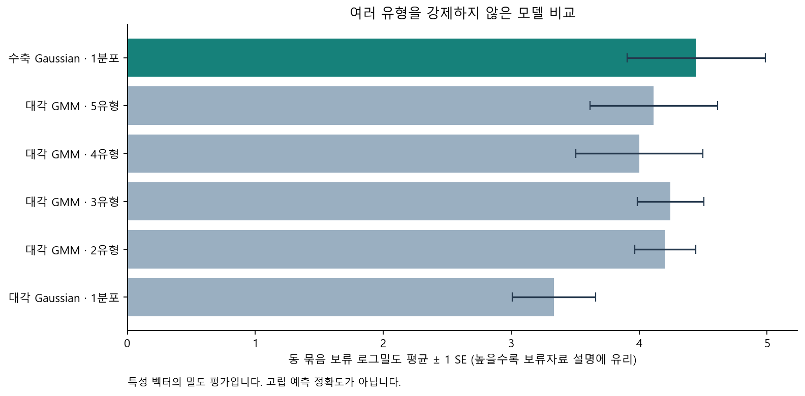
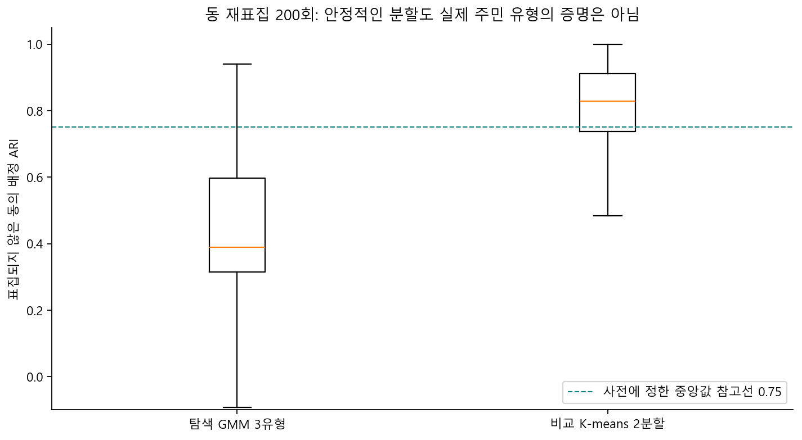
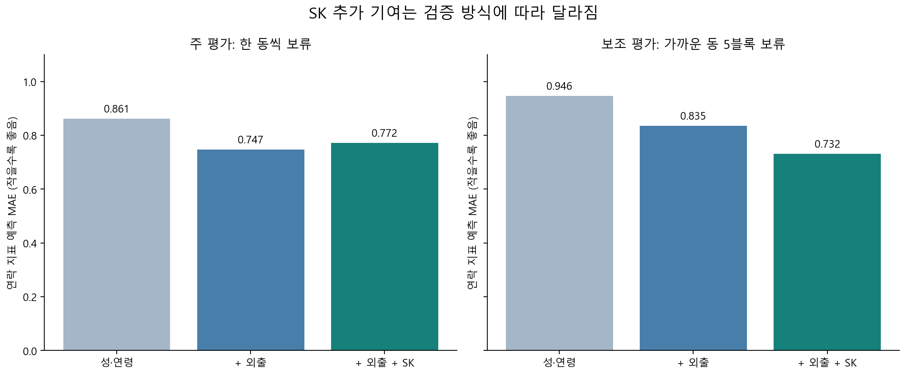

# 이음 — 빅콘테스트 2026

[](https://github.com/KangKyuC/bigcontest2026/actions/workflows/checks.yml)
[](https://github.com/KangKyuC/bigcontest2026/actions/workflows/security.yml)

**지역의 활동 특성과 지원사업의 이용조건을 함께 살펴보는 지자체 담당자용 프로젝트입니다.** 강남·춘천의 가상 사례를 정책과 대조하는 **이음 대시보드**와, 강남 22개 행정동·220개 집계 집단의 활동 특성을 복원하는 **M3 분석 코드**를 제공합니다.

**[공개 대시보드 열기](https://ieum-pink-psi.vercel.app)** · [대시보드 실행 안내](dashboard/README.md) · [최종 제출 안내](docs/SUBMISSION.md) · [보안 검토](docs/SECURITY_REVIEW.md)



대시보드는 강남 37개·춘천 17개 지원사업과 **가상 사례 75개(대표 5개·동별 70개)**의 조건 대조·검토 순서·보완 시나리오를 보여 줍니다. 사례 수는 실제 주민 수가 아니며, 1~4단계는 정해 둔 검토 규칙입니다. 생성형 언어모델이나 개인 고립 확률 예측을 구현한 것은 아닙니다.

M3의 최종 선택은 **연속 프로필 + 수축 공분산 단일 Gaussian(`shrink_1`)**입니다. 검증 기준을 충족한 고립 위험 군집은 확보하지 못했습니다. 대시보드의 가상 페르소나는 M3가 발견한 군집이 아니며, 연락·외출 관측 백분위와 별도 정책 규칙을 사용합니다. 2026-10-22 연구 결과와 이후 재현 검증을 보존합니다.

| 바로 보기 | 내용 |
| --- | --- |
| [제출본 안내](docs/SUBMISSION.md) | 구현 범위·심사 동선·실행 방법·남은 검증 |
| [대시보드](dashboard/README.md) | 원자료 없이 실행하는 화면·정책 엔진·가상 시나리오 |
| [모델 카드](docs/MODEL_CARD.md) | 관측 대상·통계 설계·결과의 의미와 한계 |
| [재현 안내](docs/REPRODUCE.md) | 원본 확보 → 전처리 → 학습·평가 → 추론 → 수치 대조 |
| [데이터 명세·공개 범위](docs/DATA_POLICY.md) | 출처·결합 단위·파일 지문·공개하지 않은 데이터 |
| [현재 성과와 다음 작업](docs/PROJECT_STATUS.md) | 대회 요구 대응·정책 분석과 연결·인계 항목 |
| [재현 검증 기록](docs/VERIFICATION.md) | 새 환경·새 폴더에서 실제로 확인한 항목 |
| [최종 결과 수치](results/m3_20261022/summary.json) | 2026-10-22 실행의 고정 결과 |

## 1. 문제와 현재 구현 범위

지역 활동량의 감소만으로 고립된 주민이나 지원 수요를 판정하기 어렵습니다. 지원사업 하나의 자격에 맞지 않는다는 사실만으로 전체 정책의 사각지대라고 판단할 수도 없습니다. 두 작업을 분리합니다.

1. **M3 활동 특성 분석:** 같은 성·연령끼리 연락·외출·장소 이용환경이 어떻게 다른지 관측하고, 유형화가 자료에서 지지되는지 검증합니다.
2. **후속 정책 경로 검토:** 지원 필요와 이용조건이 별도로 주어질 때, 사업의 기능·자격·회차·시간·장소·접촉방식과 대안을 검토합니다.

첫 번째는 원본부터 수치까지 재현할 수 있습니다. 두 번째는 정적 대시보드와 규칙 기반 조건엔진을 구현했습니다. 정책 조사 입력 전체는 공개하지 않아 화면은 제공된 스냅샷으로 실행합니다. 현장 운영 성과, 실제 미충족 수요, 정책 개선 효과는 아직 검증하지 않았습니다.



## 2. 관측 단위와 데이터

| 구분 | 단위·기간 | 활용 |
| --- | --- | --- |
| 기존 전체 활동 EDA | 강남·춘천 × 성별 2 × 연령 6 = 24집단, 2025년 7~12월 144집단·월 | 업종별 결제·유동 변화와 반례 |
| M3 주 입력 | **강남 22동 × 성별 2 × 성인 연령 5 = 220셀** | 2025-10 서울 파일의 7~9월 행동 + SK 7~9월 |
| M3 민감도 입력 | 같은 220셀 | 2025-12 서울 파일의 9~11월 행동 + SK 9~11월 |
| 외부 비교기준 | 강남을 제외한 서울 402동 × 성별 2 × 성인 연령 5 = 4,020셀/창 | 연락·외출의 같은 성·연령 비교위치 |

220셀은 220명이 아닙니다. 동을 공유하는 관측값이므로 공간 평가 단위는 22동입니다. 두 행동 관측창은 9월이 겹쳐 독립적인 미래 예측 평가가 아닙니다. 춘천에는 같은 정의의 서울 행동 자료가 없어 M3 적용 지역에 포함하지 않았습니다.

[data/sources.json](data/sources.json)에 정확한 파일명·크기·SHA-256이 있습니다. [서울시 행정동단위 29개 통신정보](https://data.seoul.go.kr/dataList/OA-22267/F/1/datasetView.do)는 실제 다운로드와 원본 지문을 확인했습니다. SK·카드 자료는 권한을 가진 참가자가 공식 대회 경로에서 별도로 확보해야 합니다.

| 핵심 변수 | 의미 | 해석의 경계 |
| --- | --- | --- |
| `contact` | 평균 통화대상자 수의 연령 표준화 지수 | 관계의 질·도움을 청할 사람 수가 아님 |
| `weekday_move` | 평일 이동 횟수 지수 | 가까운 이동의 식별 한계가 있음 |
| `holiday_move` | 휴일 이동 횟수 지수 | 사회참여의 목적·동행자는 알 수 없음 |
| `flow_per_point` | 공통 관측점당 일평균 유동 | 방문자 포함 장소 맥락, 주민 1인당 활동량이 아님 |
| `flow_concentration` | 관측점 유동 집중도 `N × Σ(점별 비중²)` | 주민의 이동반경이 아님 |
| `flow_change_log` | 창 시작·끝 월의 `log1p` 유동 차이 | 짧은 경로의 요약, 장기 추세 예측이 아님 |

5세층은 동일가중으로 합쳤습니다. 20·30·40·50대는 각 2개 층, 공개 원자료의 60세 이상 범주는 4개 층입니다. 개인 전체의 정확한 평균을 복원한 것은 아닙니다. 카드의 가맹점 위치를 주민 거주동으로 배정하거나 카드 고객과 통신 이용자를 개인별로 결합하지 않습니다.

## 3. 전처리와 모델 설계

1. **원본 검증:** 서울 XLSX 2개와 SK 성·연령 CSV 6개의 크기·SHA-256을 확인합니다.
2. **공간·기간 정렬:** 22동 코드표와 6개월 공통 관측점 **15,178개**를 원본에서 재구성합니다. 이전 중간 CSV나 DuckDB가 필요하지 않습니다.
3. **품질 관리:** 유동은 월 일수로 가중하고 결측을 0으로 바꾸지 않습니다. 원 5세층 이동 미추정 비율 20% 초과는 주의, 50% 초과는 제외합니다. 두 창 모두 220셀, 주의 셀은 주 입력 2개·민감도 입력 27개입니다. 임계값은 자료 품질 규칙입니다.
4. **학습 내 전처리:** 양의 수준 변수 `log1p`, 같은 성·연령 중심 보정, 강건 척도 변환을 적용합니다. SK 중심·척도는 학습 동에서만 적합합니다. 블록 크기 보정이 GMM 우도 기여를 동일하게 만든다는 뜻은 아닙니다.
5. **선택·평가:** 수축 단일 Gaussian과 대각 GMM 1~5성분을 비교합니다. 내부 동 그룹 5-fold와 1-SE 규칙으로 선택하고, 외부 22회 한 동 보류·5개 공간블록 보류로 평가합니다.
6. **안정성·민감도:** 동 부트스트랩 200회, OOB 배정 안정성, K-means 비교, 변수 제거·연령 보정·관측창 민감도를 확인합니다. 사후 4·6블록 진단은 탐색 분석으로 구분합니다.

[학습 전 분석계약](repro/m3/분석계약.md)과 [설정 파일](repro/m3/config.json)을 보존했습니다. 데이터를 이미 본 상태에서 작성했으므로 외부 사전등록이나 맹검 연구라고 주장하지 않습니다.

## 4. 최종 결과 수치

### 모델 선택

동 그룹 5-fold의 보류 로그밀도입니다. 높을수록 같은 변환 특성 공간의 보류 자료 설명에 유리합니다. **고립 예측 정확도가 아닙니다.**

| 후보 | 평균 | 폴드 SE | 선택 |
| --- | ---: | ---: | --- |
| 대각 Gaussian 1성분 | 3.334722 | 0.325677 | |
| 대각 GMM 2성분 | 4.204318 | 0.237256 | |
| 대각 GMM 3성분 | 4.244330 | 0.259584 | |
| 대각 GMM 4성분 | 4.001387 | 0.496160 | |
| 대각 GMM 5성분 | 4.114012 | 0.497354 | |
| **수축 Gaussian 1성분** | **4.446806** | **0.539989** | **채택** |

22회 한 동 보류에서는 수축 1성분 21회, 대각 1성분 1회가 선택됐습니다. 5개 공간블록 보류에서도 다성분이 선택되지 않았습니다. 최종 `type_adopted`는 `false`입니다.



### 유형 안정성

| 탐색 모형 | OOB ARI 중앙값 | 하위 10% | 상위 10% |
| --- | ---: | ---: | ---: |
| GMM 3유형 | 0.389740 | 0.233082 | 0.785193 |
| K-means 2분할 | 0.829349 | 0.543585 | 0.949991 |

GMM 3유형은 재표집에 민감했습니다. K-means의 안정적인 절단도 실제 주민 유형이나 고립 상태의 정답을 입증하지 않습니다. K=1의 ARI와 소속확률 100%는 자명한 값이므로 신뢰도나 성능으로 내보내지 않습니다.



### SK의 추가 정보 평가

별도 Ridge 과제로 **관측된 통화대상자 지수**를 예측했습니다. 성·연령 기준, 외출 추가, SK 추가를 같은 보류 셀에서 비교했습니다. 연락 목표값과 문자·SNS를 입력해 목표를 우회 재현하지 않았습니다.

| 보류 방식 | 입력 | MAE ↓ | RMSE ↓ | R² |
| --- | --- | ---: | ---: | ---: |
| 한 동씩 보류 | 성·연령 | 0.861167 | 1.141811 | 0.897340 |
| 한 동씩 보류 | + 외출 | 0.746729 | 1.016473 | 0.918641 |
| 한 동씩 보류 | + 외출 + SK | 0.771745 | 1.043080 | 0.914326 |
| 공간 5블록 보류 | 성·연령 | 0.945748 | 1.228582 | 0.881144 |
| 공간 5블록 보류 | + 외출 | 0.834588 | 1.115045 | 0.902097 |
| 공간 5블록 보류 | + 외출 + SK | 0.731694 | 0.986351 | 0.923392 |

외출 기준 MAE에서 SK 추가 MAE를 뺀 개선량은 주 평가 **−0.025016**, 동 재표집 95% 근사 구간 **[−0.191542, 0.104993]**입니다. 공간 5블록의 블록 평균 개선량은 **+0.104595 [0.031397, 0.168308]**였지만 블록이 5개뿐입니다. 사후 4·6블록 진단의 구간은 0을 포함했습니다.

따라서 **SK의 일관된 예측 개선을 입증하지 못했습니다.** 공간 맥락으로 유용할 가능성과 정책 판단을 개선한다는 주장은 별도로 검증해야 합니다. R²는 연락 지수의 예측값이며 고립 분류 성능이 아닙니다. 구간은 고정 OOF 오차의 그룹 재표집으로 전체 재학습 불확실성을 포함하지 않습니다.



## 5. 결과의 의미와 활용

연락과 외출을 분리하면 서로 다른 조사 질문이 생깁니다. 공개 행동 지표 기준으로 개포2동 20대 여성 셀의 연락 비교위치는 약 2.49백분위, 평일 이동은 89.80백분위였습니다. 논현1동 30대 여성 셀은 각각 97.01·0.75백분위였습니다. 집계 평균의 비교이므로 해당 조건의 모든 개인을 설명하지 않습니다.

- 연락이 낮고 외출이 높은 경우: 전화 외 교류와 이동 목적을 확인할 질문이 생깁니다.
- 연락이 높고 외출이 낮은 경우: 원격 교류·생활 동선·가까운 이동의 측정 한계를 확인해야 합니다.
- 여러 행동 비교위치가 낮은 경우: 관측 누락과 지원 희망을 확인해야 하며, 고립자나 지원 대상자로 자동 판정하지 않습니다.

기존 EDA의 7~8월 대비 11~12월 변화는 다음과 같습니다. 카드 건수는 각 기간의 달력 일수로 나눴습니다.

| 춘천 집단 | 전체 결제 | 유동 | 좁은 시설 결제 | 스포츠시설 결제 |
| --- | ---: | ---: | ---: | ---: |
| 40대 여성 | −4.40% | −2.02% | −46.01% | −63.04% |
| 20대 남성 | +8.63% | +2.78% | −48.32% | −64.60% |
| 60세 이상 남성 | −3.29% | −3.40% | −13.21% | −9.40% |

스포츠시설 감소는 춘천 12개 성·연령 집단 모두에서 나타나 특정 집단 고립의 증거로 쓰기 어렵습니다. [전체 24집단 수치](results/m3_20261022/activity_contrasts.csv)와 [서술 비교 재현](docs/REPRODUCE.md#선택-24집단-활동-eda)을 별도로 제공합니다.

**현재 조사 질문과 대표 사례의 상당 부분은 공개 행동 지표의 비교위치만으로 만들 수 있습니다. 학습된 Gaussian이 그 질문에 필수적이거나 정책 판단을 개선했다는 검증은 아직 없습니다.**

## 6. 실행과 복원

### 대시보드 먼저 보기

Node.js 24 이상이 필요합니다. 공개 스냅샷을 포함하므로 대회 원자료나 Python 서버 없이 실행할 수 있습니다.

```bash
npm --prefix dashboard ci --ignore-scripts
npm --prefix dashboard run dev
```

브라우저에서 `http://127.0.0.1:5173`을 엽니다. 빌드는 `npm --prefix dashboard run build`입니다. [대시보드 안내](dashboard/README.md)에 정책 규칙과 스냅샷 재생성의 입력 조건이 있습니다.

공개 저장소에는 코드·출처 지문·집계 성능표·도표를 포함합니다. 대회 원본, 220셀 입력·행별 추론·정책 인계 데이터와 학습 바이너리는 배포하지 않습니다. 권한 있는 원본을 배치하면 모델 파일과 전체 결과표를 로컬에서 다시 생성할 수 있습니다.

### 원자료 없이 코드 확인

Python 3.11·PowerShell 예시입니다. macOS/Linux 명령은 [재현 안내](docs/REPRODUCE.md)에 있습니다.

```powershell
git clone https://github.com/KangKyuC/bigcontest2026.git
Set-Location bigcontest2026
py -3.11 -m venv .venv
& ./.venv/Scripts/python.exe -m pip install -r requirements.txt
& ./.venv/Scripts/python.exe -m unittest discover -s tests -v
```

이 시험은 합성 입력을 사용하는 코드 계약 검증입니다. 실제 성능 재현과 구분합니다.

### 권한 있는 원본으로 전체 재현

SK 원본 6개를 `data/raw/contest/sk/`에 둔 뒤 실행합니다. 다른 데이터 경로는 `--data-root`로 지정할 수 있습니다.

```powershell
& ./.venv/Scripts/python.exe repro/m3/fetch_public.py
& ./.venv/Scripts/python.exe repro/m3/verify_sources.py
& ./.venv/Scripts/python.exe repro/run.py
& ./.venv/Scripts/python.exe repro/m3/predict.py --input repro/m3/data/model_input_primary.csv --output repro/m3/results/predictions.csv
```

기본 실행은 전처리 → 학습·평가 → 추가 공간 진단 → 25개 검증 → 기준 결과 대조입니다. 생성 경로의 이전 결과를 갱신하므로 별도 실행을 보존하려면 저장소 사본을 사용합니다. 보고서는 다음 명령으로 생성합니다.

```powershell
& ./.venv/Scripts/python.exe -m pip install -r requirements-report.txt
& ./.venv/Scripts/python.exe repro/run.py --stages report
```

생성 파일은 `repro/m3/` 아래에 있습니다.

| 경로 | 결과 |
| --- | --- |
| `models/m3_bundle.joblib` | 학습된 전처리·최종 모델 |
| `models/m3_parameters.json` | 보고서 단계에서 저장하는 읽을 수 있는 파라미터 |
| `results/group_profiles.csv` | 전체 220셀 프로필 |
| `results/policy_handoff.json` | 관측과 미확인 조건을 분리한 정책팀 인계 |
| `results/reference_comparison.json` | 원 연구 기준 수치와 비교 |
| `report/` | Markdown·Word·Excel·PDF·PNG |

`joblib`은 신뢰하는 로컬 생성 파일만 불러옵니다.

## 7. 저장소 구성

```text
README.md                         결과·해석·실행 진입점
dashboard/                        React 지도 화면·공개 스냅샷·정책 규칙
requirements*.txt                 통계 핵심·보고서 의존성
data/sources.json                 원본 크기·SHA-256·출처
docs/                             모델 카드·재현·데이터·후속 작업
docs/figures/                      GitHub에서 볼 수 있는 결과 도표
repro/run.py                      단계별 전체 실행
repro/m3/prepare_data.py           원본에서 440셀·비교기준·품질검사 재구성
repro/m3/train_evaluate.py         선택·중첩 평가·안정성·보조 예측
repro/m3/validate_model.py         실제 데이터 25개 검증
repro/m3/compare_reference.py      고정 수치 대조
repro/m3/analyze_activity.py       선택: 24집단 카드·SK 서술 EDA
results/m3_20261022/               원 연구의 고정 성능표·민감도
tests/                            원자료 없는 계약 시험
.github/workflows/                공개 코드·빌드·의존성·비밀정보·CodeQL 검사
```

생성 입력·모델·행별 결과·개인 환경은 Git에서 제외합니다. 기존 `analysis/`와 팀 문서 원본은 로컬에 보존하며 공개 패키지와 구분합니다.

## 8. 대회 요구와 남은 검증

| 요구 영역 | 현재 근거 | 남은 간극 |
| --- | --- | --- |
| 지역·연령 비교, 특성 | 24집단 서술 비교·강남 220셀 프로필 | 사회적 고립과 직접 관계 미검증 |
| 모델 개발·성능·재현 | 동·공간 보류, 안정성, 별도 연락 예측 | 고립 발생·심화의 독립 정답이 없음 |
| 위험도 해석 | 밀도·비교위치·군집 미채택을 명시 | 고립 확률·위험계층 규모로 바꿀 수 없음 |
| AI 판단·자원 연계 | 규칙 기반 정책 조건 대조·대시보드·가상 시나리오 | 실제 주민·현장 성과·모델의 추가 기여에 대한 독립 평가 필요 |

다음 검증은 같은 사례에서 **B0 정책·인구·조사 → B1 공개 행동 특성 → B2 제공 SK → B3 학습 모델**을 차례로 추가하는 것입니다. 자격 판정은 유지하면서 조사 질문·반례·정책 검토가 무엇 때문에 개선되는지 기록해야 합니다. 이 실험은 아직 완료하지 않았습니다.

공식 주제설명서의 고립 위험 예측·분류 요구를 M3가 모두 충족한다고 보증하지 않습니다. 제공 데이터 활용, 모델 적합성, 정책 의사결정 기여는 서로 다른 검증 과제입니다.

## 출처와 이용 범위

- 대회 주제·제공 자료: [빅콘테스트 공식 사이트](https://www.bigcontest.or.kr/), 로컬 주제설명서 `2026 빅콘테스트 주제설명자료_260907.pdf` 6~10쪽.
- 공개 행동 자료: 서울특별시 [행정동단위 29개 통신정보](https://data.seoul.go.kr/dataList/OA-22267/F/1/datasetView.do), 2025-10·2025-12 파일 및 제공 매뉴얼. 공개 안내의 공공누리 1유형에 따라 출처를 표시합니다.
- 방법: [scikit-learn 혼합모형](https://scikit-learn.org/1.6/modules/mixture.html), [공분산 추정](https://scikit-learn.org/1.6/modules/covariance.html), [교차검증](https://scikit-learn.org/1.6/modules/cross_validation.html). 실행 버전은 1.6.1입니다.

데이터별 권리는 제공기관 조건을 따릅니다. 저장소 공개가 대회 데이터 재배포 허가를 뜻하지 않습니다. [데이터 공개 범위](docs/DATA_POLICY.md)를 함께 확인합니다.
